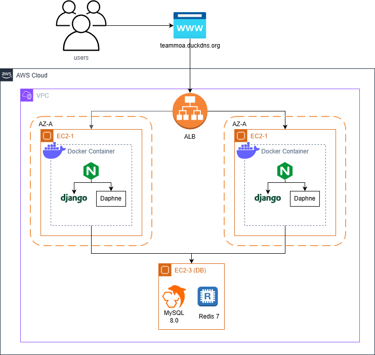
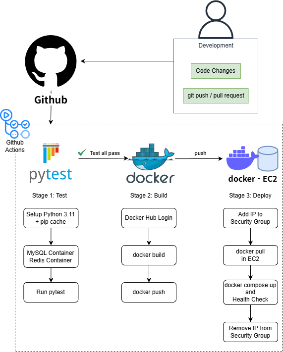
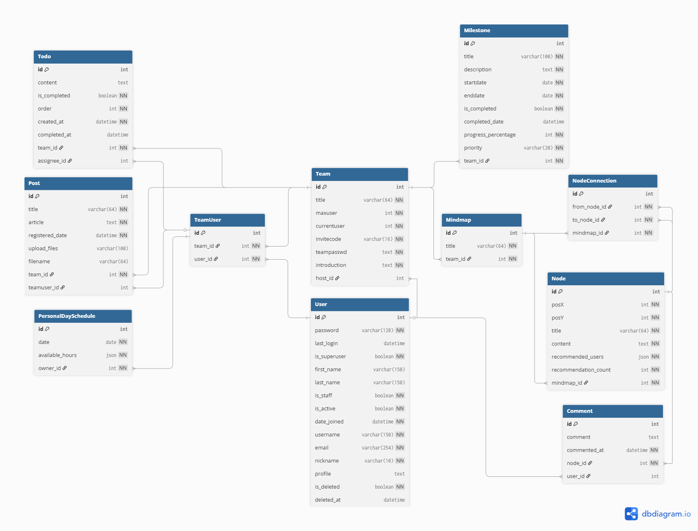
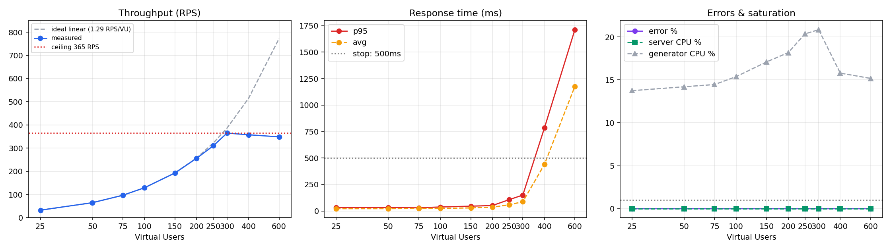

# TeamMoa

Django 기반 팀 협업 플랫폼. 스케줄 조율, 실시간 마인드맵, TODO·마일스톤 관리를 한 곳에서 제공한다.

[](https://djangoproject.com/) [](https://python.org/) [](https://mysql.com/) [](https://docker.com/)

대학 팀 프로젝트 TeamMoa를 1인으로 재설계·리팩토링한 프로젝트 (2025.08 ~ 2026.09)

`FBV → CBV → 서비스 레이어 → REST API 분리 → WebSocket 실시간 협업 → Docker·CI/CD·AWS 배포 → 부하 테스트`

배포 서버는 현재 중단 상태다. 동작은 아래 [시연](#시연) GIF 참고.

## 핵심 성과

| 영역 | 문제 | 해결 | 결과 |
|---|---|---|---|
| 처리량 | 단일 프로세스에서 호스트 CPU 25~36%인데 91 RPS에서 정체 | 프로세스 1/3/6개 대조 실험으로 병목 특정, Nginx + Daphne 6프로세스 | **90.9 → 364.5 RPS (4.0배)** |
| DB 쿼리 | 팀원 수에 비례해 쿼리 증가 (5명 16개, 100명 301개) | `annotate` + `prefetch_related` | **페이지별 75~83% 감소** |
| 무중단 배포 | Rolling Update 중 요청 약 5%가 502 | ALB Deregistration Delay 조정 + 대기 로직 워크플로 자동화 | **15,000건 중 502 0건** |

<!-- AUTO:TEST_COUNT -->
pytest 264개 테스트 · GitHub Actions CI/CD · AWS ALB + Multi-AZ EC2 · [트러블슈팅 12건](./docs/technical/troubleshooting.md)

## 목차

- [시연](#시연)
- [기술 스택 & 선택 이유](#기술-스택--선택-이유)
- [성능 검증 — 부하 테스트로 한계점 탐색](#성능-검증--부하-테스트로-한계점-탐색)
- [기술 문서](#기술-문서)
- [빠른 시작](#빠른-시작)
- [프로젝트 구조](#프로젝트-구조)
- [한계](#한계)
- [라이선스](#라이선스)

## 시연

| 마인드맵 동시 편집 | TODO 할당 (팀장 화면) |
|---|---|
|  |  |

| 기능 | 설명 |
|---|---|
| 팀 대시보드 | 마일스톤 진행 현황 요약, 팀원 목록, 팀 정보(팀 코드, 설명), 팀장 권한 관리 |
| TODO 관리 | 할 일 → 팀원 → 완료 3단 보드, 드래그앤드롭 할당, 팀장/팀원 권한별 UI |
| 실시간 마인드맵 | Canvas 노드 에디터, WebSocket 동시 편집, 다중 사용자 커서 표시 |
| 마일스톤 타임라인 | 연간 타임라인, 드래그로 일정 변경, 진행률 수동 입력 또는 TODO 완료율 자동 계산 |
| 팀 스케줄 | 7일 × 24시간 가용성 그리드, 전원 가능한 시간 자동 표시, CSV 업로드 |

화면별 스크린샷과 세부 동작: [docs/features.md](./docs/features.md)

## 기술 스택 & 선택 이유

```
Backend:        Django 5.2.4 | Django Channels | Django REST Framework | MySQL 8.0 | Redis 7.0
Frontend:       HTML, CSS, JavaScript (Canvas API, Fetch API)
Infrastructure: AWS ALB | EC2 (Multi-AZ) | Docker Compose | Nginx | ACM SSL
DevOps:         GitHub Actions (Rolling Update) | Docker Hub
Architecture:   Service Layer Pattern | Hybrid SSR + API
Testing:        pytest | Locust (부하 테스트)
```

- **Django Channels + Redis** — 마인드맵 동시 편집용 WebSocket, Redis 채널 레이어로 프로세스 간 메시지 브로드캐스트
- **서비스 레이어** — SSR 뷰와 API가 같은 비즈니스 로직을 공유하고, 뷰 없이 로직 단위로 테스트
- **하이브리드 SSR + API** — 게시판 등 정적 화면은 SSR, TODO·스케줄처럼 상호작용이 많은 화면은 API + Fetch로 부분 갱신
- **Daphne(ASGI) + Nginx** — HTTP와 WebSocket을 한 서버에서 처리, Nginx가 TLS 종료와 리버스 프록시 담당

자세한 근거: [아키텍처 설계](./docs/technical/architecture.md), [프로젝트 개요](./docs/technical/overview.md#기술-스택-및-선택-이유)

### AWS 인프라



### CI/CD 파이프라인

GitHub Actions로 테스트 → 빌드 → 배포



<details>
<summary>데이터베이스 ERD</summary>



</details>

## 성능 검증 — 부하 테스트로 한계점 탐색

2026.09.11 로컬 측정. 처리량 천장을 찾고, 무엇이 먼저 한계에 닿는지 특정한 뒤,
배포 구성을 바꿔 천장을 4.0배 올렸다. 측정 절차와 전체 데이터: [REPORT.md](./docs/guides/load-testing/local-knee/REPORT.md)

측정 원칙

- 중단 조건(`p95 > 500ms` 또는 `에러율 > 1%`)을 측정 전에 고정하고 결과를 보고 바꾸지 않았다.
- 부하 생성기는 별도 기계에서 돌리고, 생성기 CPU(최대 20.8%)·네트워크(용량의 19%)를 기록해 병목이 아님을 확인했다.
- 서버 CPU, MySQL 커넥션, 호스트 부하를 3초 간격으로 수집해 부하 곡선과 같은 시간축에 놓았다.

### 결과 — Nginx + Daphne 6프로세스

| VU | RPS | 평균 | p95 | 에러율 |
|---:|---:|---:|---:|---:|
| 25 | 32.2 | 22ms | 31ms | 0% |
| 50 | 64.5 | 22ms | 32ms | 0% |
| 100 | 128.9 | 25ms | 38ms | 0% |
| 150 | 192.6 | 29ms | 46ms | 0% |
| 200 | 255.7 | 36ms | 52ms | 0% |
| 250 | 309.9 | 59ms | 107ms | 0% |
| **300** | **364.5** | 87ms | 150ms | 0% |
| 400 | 357.5 | 439ms | **784ms** | 0% |
| 600 | 348.4 | 1,177ms | 1,712ms | 0% |


*좌: RPS와 선형 기준선 · 중: 응답시간 · 우: 에러율과 서버/생성기 CPU*

### 핵심 결론

| | 값 |
|---|---|
| 선형 확장 구간 | VU 25~200 — VU당 1.286 RPS로 예측한 값 대비 오차 ±0.6% 이내, p95 30~52ms 유지 |
| 처리량 천장 | **364.5 RPS** — VU 300/400/600 세 점이 348~365에 평평 |
| 무릎 | VU 300~400 (p95 150ms → 784ms) |
| 먼저 닿은 한계 | **호스트 물리 코어 6개** (아래 대조 실험) |

### 병목 확정 — 프로세스 1 / 3 / 6개 대조 실험

같은 VU 400에서 프로세스 수만 바꿔 재측정했다.

| 구성 | 프로세스당 CPU | 컨테이너 CPU 합계 | RPS | 해석 |
|---|---:|---:|---:|---|
| 1프로세스 | 127% | 1.5코어 | 90.9 | GIL 천장. 호스트 CPU 25~36%로 여유 |
| 3프로세스 | 134% | 4.7코어 (물리 6코어 이내) | 222.3 | 프로세스별 GIL까지 도달 |
| 6프로세스 | 109% | 7.6코어 (물리 6코어 초과) | 345.3 | 물리 코어 부족으로 억제 |

3프로세스에서 프로세스당 CPU가 단일 프로세스보다 높으므로 GIL은 천장이 아니다.
6프로세스에서 109%로 떨어지는 것은 물리 코어가 바닥났기 때문이고(`6코어 × SMT 실효 1.27 ≈ 7.6코어`, 실측 7.59),
DB는 `Threads_running` 2~3으로 전 구간 한가했다. 단일 프로세스 구성의 한계는 하드웨어가 아니라 배포 구성이었다.

### 측정 환경

| | 서버 | 부하 생성기 |
|---|---|---|
| 하드웨어 | Ryzen 5 5600 (6C/12T), 32GB | i7-8750H (6C/12T), 17GB |
| 스택 | Docker (WSL2) — Nginx + Daphne ×6 + MySQL 8.0 + Redis 7 | Locust master + 워커 6개 |
| 설정 | prod 상속, `DEBUG=False`, throttle 해제², `max_connections=2000`² | `wait_time = between(0.5, 1)` |

² 의도적 차이. DRF throttle은 익명 로그인에 IP 단위로 걸려 단일 생성기에서는 서버 한계가
아니라 DRF 카운터를 재게 되므로 해제. `max_connections` 는 측정 당시 커넥션 설정 이슈로 상향(이후 수정). 둘 다 [리포트](./docs/guides/load-testing/local-knee/REPORT.md)에 명시.

이전 AWS 측정(2025.12.16, ALB + EC2 t3.micro ×2)은 하드웨어와 부하 밀도가 달라 절대값을 비교할 수 없다.
[load-test-report.md](./docs/guides/load-testing/load-test-report.md)

## 기술 문서

### 핵심 문서

- [프로젝트 개요](./docs/technical/overview.md) — 배경, 핵심 기능, 성과, 학습 내용
- [아키텍처 설계](./docs/technical/architecture.md) — 서비스 레이어 패턴, 하이브리드 SSR+API
- [인프라 및 배포](./docs/technical/infrastructure.md) — Docker, CI/CD, AWS EC2
<!-- AUTO:TEST_COUNT -->
- [테스트 전략](./docs/technical/testing.md) — 264개 테스트, fixture 패턴
- [트러블슈팅](./docs/technical/troubleshooting.md) — 12건 문제 해결 사례

### 기능 상세

- [실시간 마인드맵](./docs/technical/features/realtime-mindmap.md) — WebSocket + Canvas API
- [OAuth 2.0 인증](./docs/technical/features/oauth-authentication.md) — django-allauth, 계정 병합
- [성능 최적화](./docs/technical/features/performance-optimization.md) — N+1 쿼리 해결, 페이지별 75~83% 감소

## 빠른 시작

### 로컬 개발 환경

```bash
# 1. 프로젝트 클론
git clone https://github.com/TlesMes/TeamMoa-Refactor.git
cd TeamMoa-Refactor

# 2. 환경 변수 설정
cp .env.example .env
# .env 파일에서 데이터베이스 설정 완료

# 3. Docker Compose로 실행
docker-compose up -d

# 4. 마이그레이션 및 슈퍼유저 생성
docker-compose exec web python manage.py migrate
docker-compose exec web python manage.py createsuperuser

# 5. 접속
# http://localhost:8000
# http://localhost:8000/admin (관리자 페이지)
```

### 프로덕션 배포

```bash
# GitHub Actions 자동 배포 (main 브랜치 push 시)
git push origin main

# 수동 배포
docker-compose -f docker-compose.prod.yml up -d
```

## 프로젝트 구조

```
TeamMoa-Refactor/
├── accounts/           # 인증 시스템 (이메일 인증, OAuth 2.0, Soft Delete)
├── teams/              # 팀 & 마일스톤 관리 (권한 시스템)
├── members/            # 멤버 & TODO 관리 (API 기반 실시간 UI)
├── schedules/          # 스케줄 & 가용성 관리 (JSON 168슬롯)
├── mindmaps/           # 실시간 마인드맵 협업 (WebSocket + Canvas)
├── shares/             # 공유 게시판 & 파일 관리 (드래그 앤 드롭)
├── TeamMoa/            # Django 설정 (settings/, asgi.py, urls.py)
├── static/             # 정적 파일 (CSS 모듈, JavaScript)
├── templates/          # 템플릿 (base_team, base_user, base_public)
├── deploy/             # 배포 설정 (Nginx, entrypoint, cron)
│   └── loadtest/       # 부하 테스트용 Compose 파일
├── docs/               # 프로젝트 문서
│   ├── api/            # OpenAPI 스펙 (openapi.yaml)
│   ├── technical/      # 기술 문서 (아키텍처, 인증, 실시간, CI/CD)
│   ├── architecture/   # 아키텍처 설계 & 리팩토링 히스토리
│   │   ├── design/     # 정적 구조 (API 매핑, 가이드라인)
│   │   ├── refactoring/# 시간의 흐름 (CBV, 서비스, API, Mindmaps)
│   │   └── migration/  # 마이그레이션 로드맵
│   ├── guides/         # 설정 가이드 (OAuth, 배포, 테스트)
│   ├── development/    # 성능, UI/UX, 기능 개선
│   └── troubleshooting/# 문제 해결 사례
├── .github/workflows/  # GitHub Actions CI/CD 파이프라인
├── docker-compose.yml  # 개발 환경 Docker 설정
├── docker-compose.prod.yml # 프로덕션 환경 Docker 설정
└── pytest.ini          # 테스트 설정
```

## 한계

- 배포 서버는 중단 상태다. AWS 구성과 배포 과정은 [인프라 문서](./docs/technical/infrastructure.md) 참고.
- 성능 수치는 로컬 Docker(WSL2) 환경 측정값이라 클라우드 환경 절대값과 직접 비교할 수 없다.
- 프론트엔드는 Vanilla JS로 작성했다. 백엔드 중심 프로젝트다.

## 라이선스

MIT License
