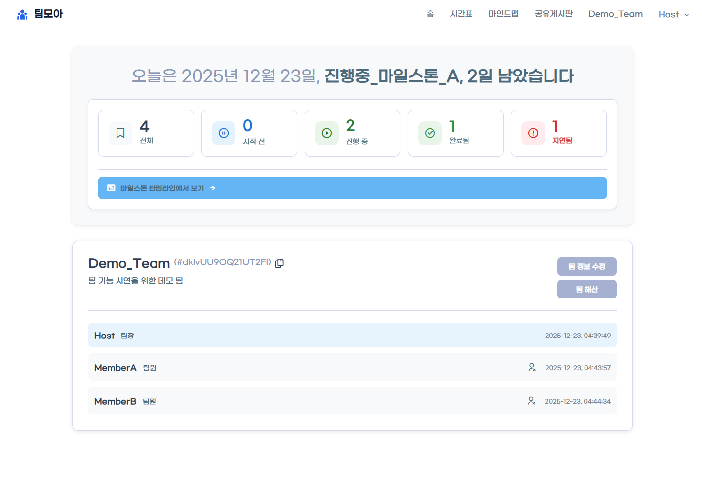
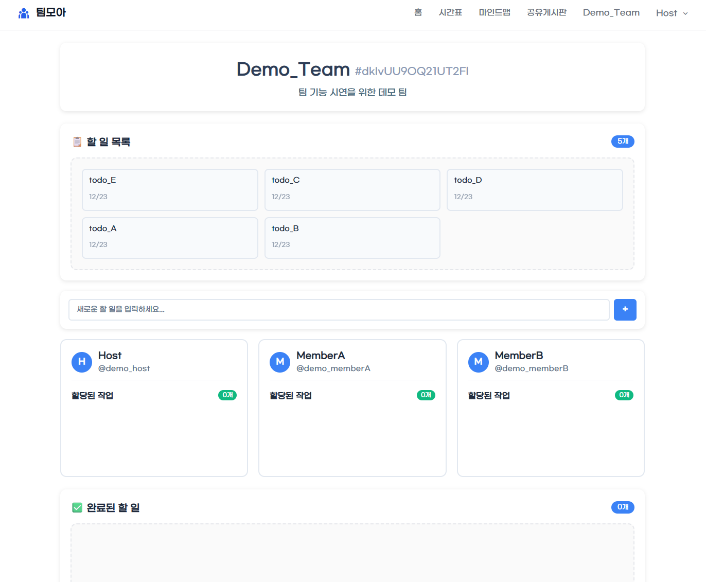
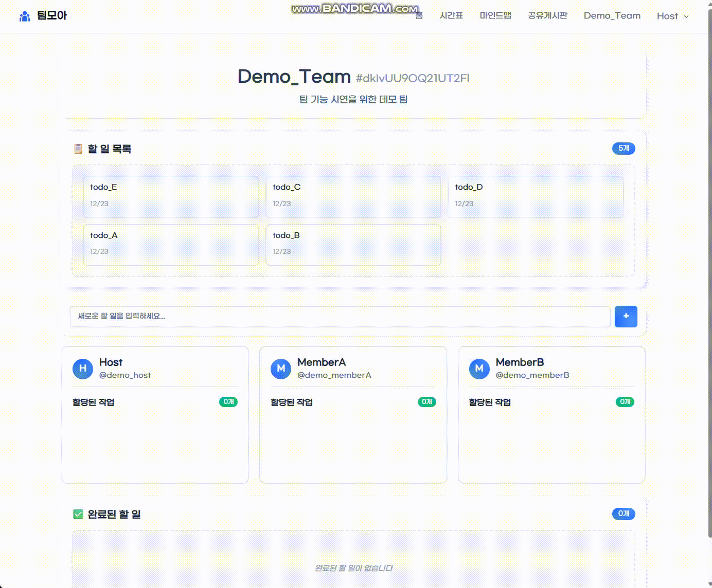
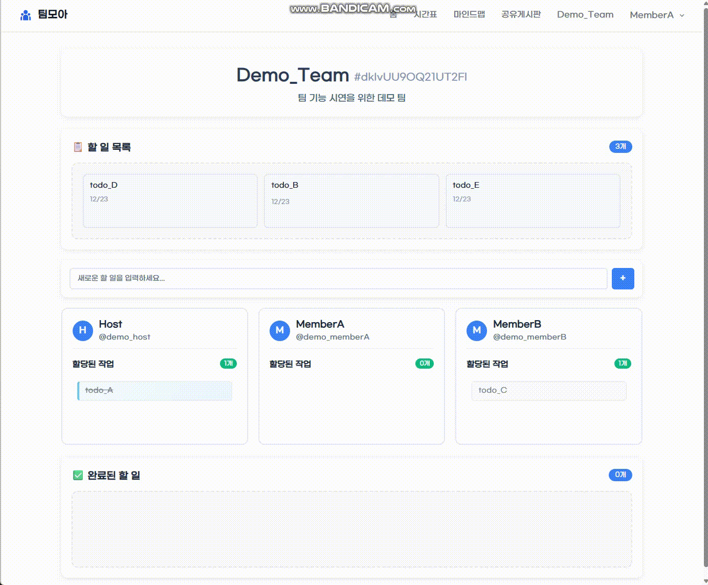
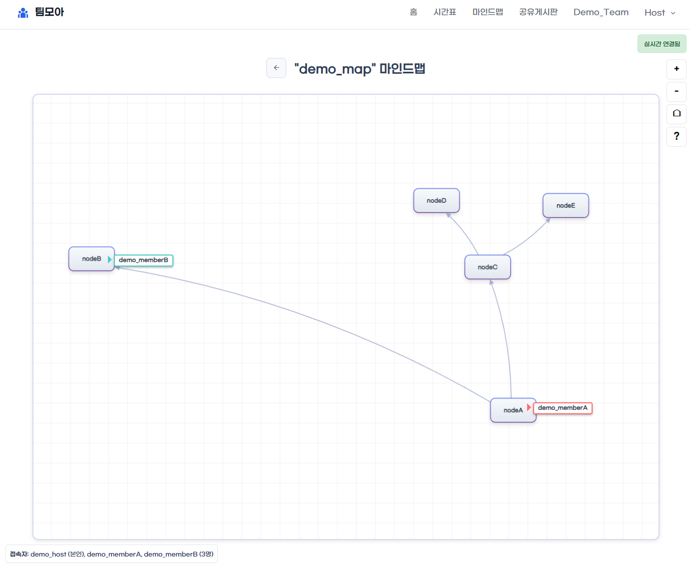
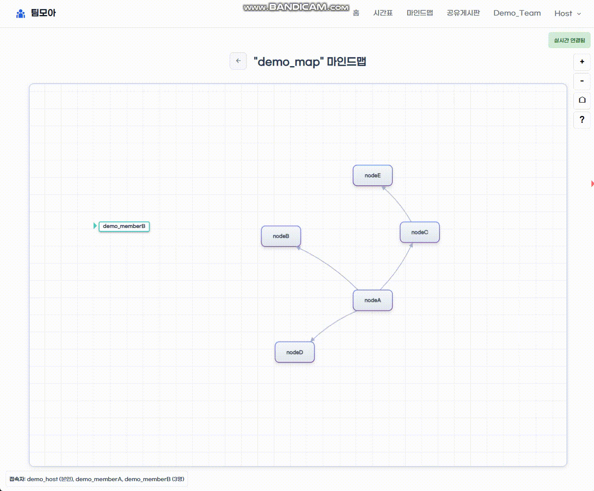
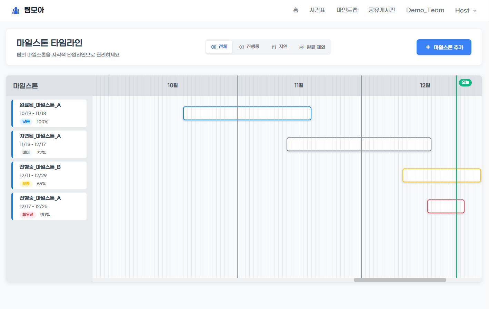
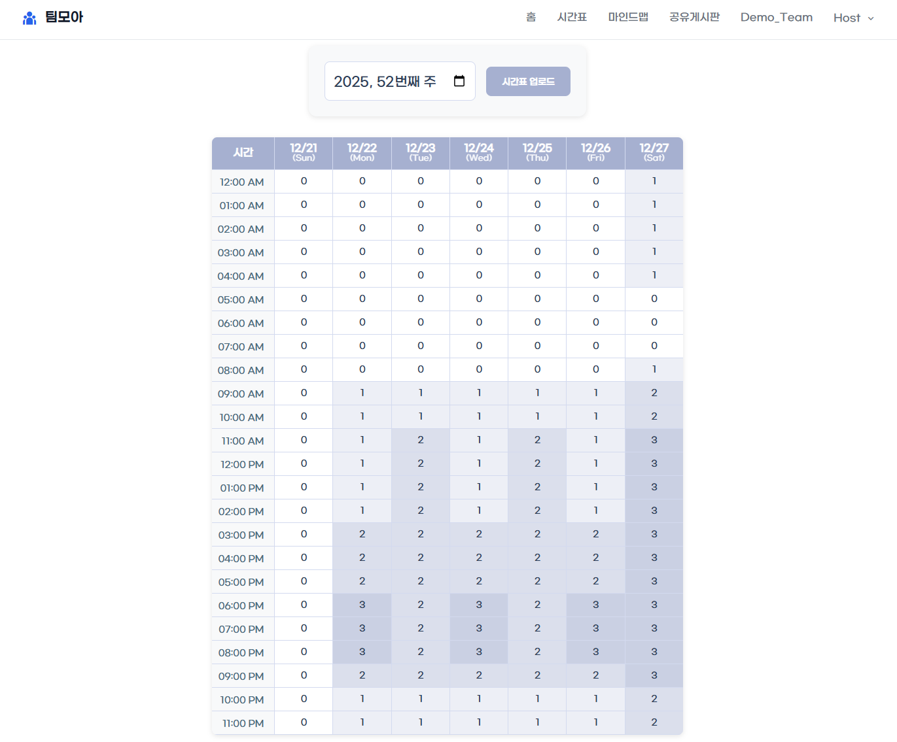

# 주요 기능

README에서 요약한 기능 5개의 화면과 세부 동작. [README로 돌아가기](../README.md)

## 팀 대시보드

- 마일스톤 진행 현황 요약 (전체/진행 중/완료/지연)
- 팀원 목록 및 가입 시간 표시
- 팀 정보 카드 (팀 코드, 설명)
- 팀 관리 및 해체 (팀장 권한)

## TODO 관리

팀장 화면 — TODO 할당

팀원 화면 — TODO 처리

- 3단 보드 구조 (할 일 → 팀원 → 완료)
- 드래그앤드롭으로 TODO 할당
- 팀장/팀원 권한별 UI
- 상태 변경 즉시 반영

## 실시간 마인드맵

- Canvas 기반 노드 에디터
- 드래그로 노드 이동, Ctrl + 드래그로 연결선 생성
- WebSocket으로 편집 내용 동기화
- 다중 사용자 커서 표시

## 마일스톤 타임라인

- 연간 타임라인 캘린더
- 드래그로 마일스톤 날짜 변경
- 상태별 색상 구분 (진행 중, 완료, 지연)
- 진행률 추적 (수동 입력 또는 연결된 TODO 완료율로 자동 계산)

## 팀 스케줄 & 가용성

- 주간 가용성 그리드 (7일 × 24시간)
- 팀원별 가용 시간 시각화
- 모든 팀원이 가능한 시간 자동 표시
- CSV 업로드로 일정 등록
